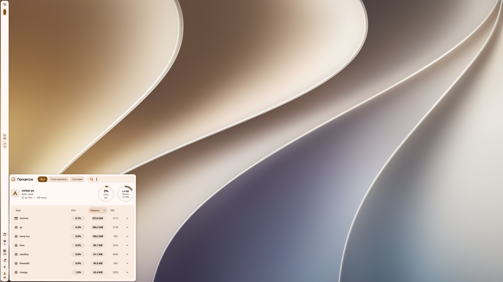
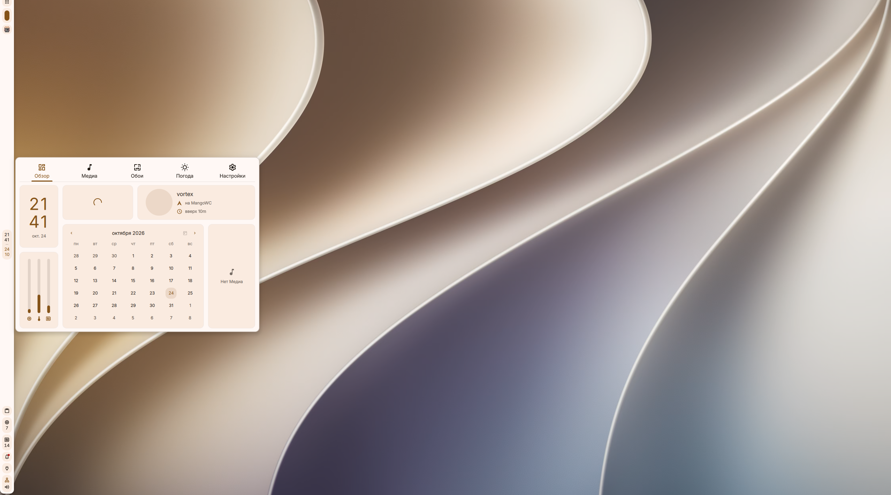
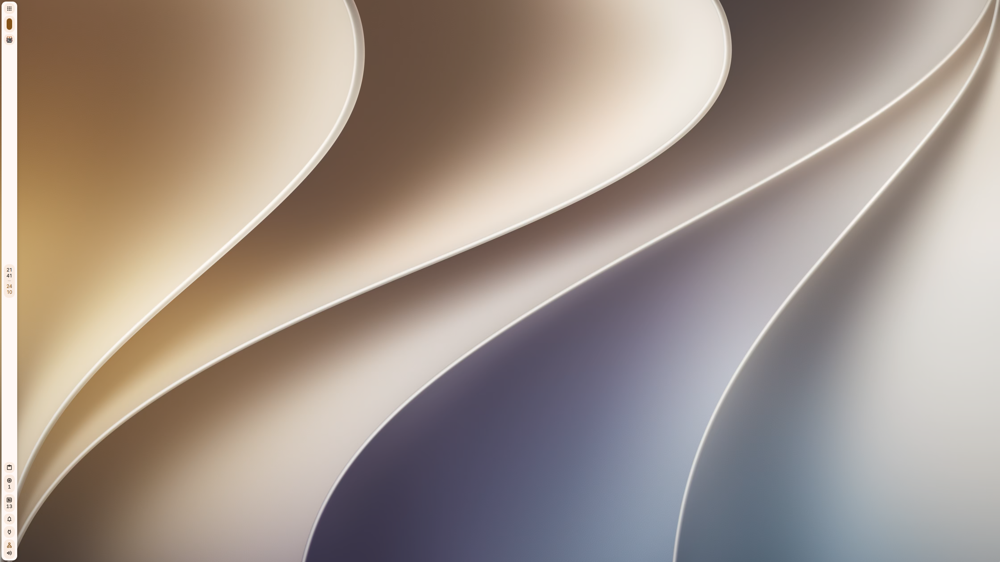

# vortex-_- Dotfiles

 My personal desktop configuration based on "Arch Linux", "MangoWM", and "DankMaterialShell(DMS)".

## Features
 - "MangoWM": Floating windows, smooth animations, and rounded corners.
 - "DankMaterialShell": Stylish top/side panel with a built-in Control Center.
 - "Kitty": Custom terminal with transparency, blur, and cursor animation.
 - "Dynamic Colors": Integrated with 'matugen' for Material You styling.

## Dependencies
 Before installing, make sure you have the required packages:
  *sudo pacman -S mango dms kitty swaybg xdg-desktop-portal-gtk polkit-kde-agent msnap*

## Installation

1. Clone the repository:

*git clone https://github.com/vortex-dotfiles/vortex-dots.git*

2. Run the installation script:

*chmod +x install.sh*
*./install.sh*

## Keybindings (Windows-like, for an easy transition to the WM)

Super + T - Terminal (kitty)
Super + D - DMS Search
Super + E - File Manager (nautilus)
Alt + F4 - Close window
Alt + Shift - Switch keyboard layout (for russian RU-EN)
Super + U - Screenshot

## Screenshots

## Acknowledgements

Special thanks to **[xtheeq](https://github.com/xtheeq)** for developing **[msnap](https://github.com/xtheeq/msnap)**. This excellent screenshots tool is  specifically designed for MangoWM. Its intuitive GUI and seamless integration make the workflow much smoother and closer to the experience users love in GNOME.

*If you find the screenshot functionality useful, please consider starring the original [msnap repository](https://github.com/xtheeq/msnap)!*